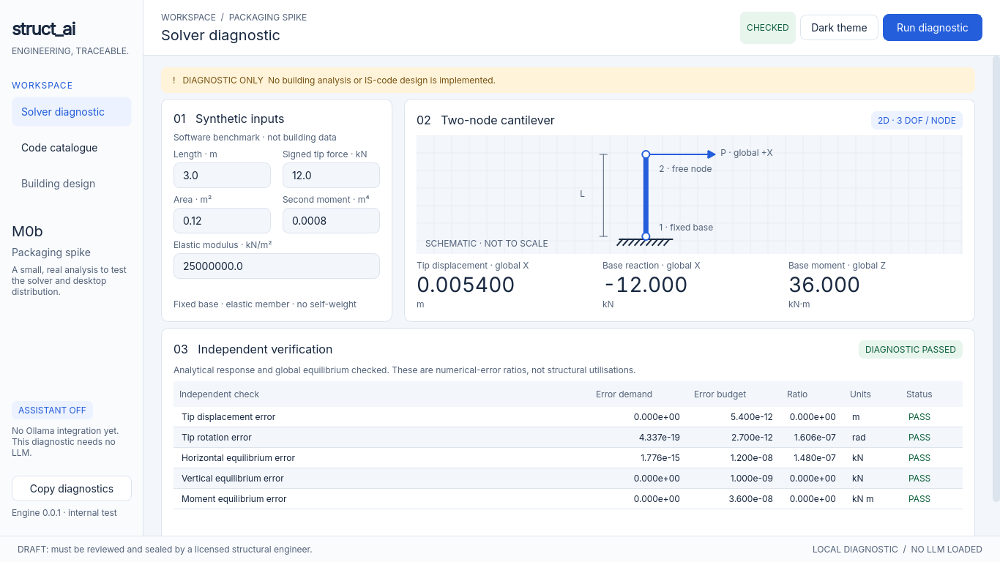
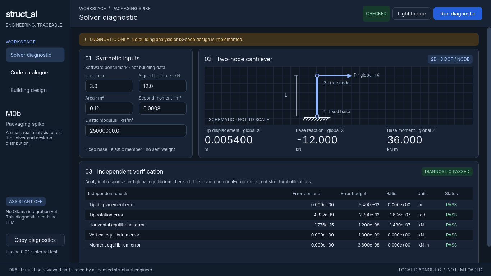

# Milestone report

## Current decisions and M1 start (2026-11-27)

**M0b clean-Windows execution is accepted on the user's report.** The user selected
`clean_full_test`: no Python/Qt/OpenSees/Ollama installed, all five GUI diagnostic
checks and both documented selftests passed. No OS version, JSON reports or native
screenshots were supplied for independent review. [Separate user-report evidence](docs/evidence/m0b/user-reported-windows-acceptance-2026-11-27.json)
records those limits; it does not rewrite the historical CI flags below. Retain the
OS/build, both JSON reports/exit codes and hashes for the eventual audit. Native DPI,
performance, accessibility and release-licensing gates remain outstanding.

The user also explicitly authorised **cited public-source numerical draft
implementation**, always unverified, with missing/ambiguous/amendment-dependent
provisions blocking affected calculations. The selected distribution intent is
**internal use**. Keep OpenSees initially; researching PyNite is not backend validation
or replacement. Ollama remains requested and planned, not implemented or live-tested.

M1 is now starting: rectangular/doubly reinforced/T/L **section** flexure services,
traceable data and independent tests. See the [updated plan](docs/IMPLEMENTATION_PLAN.md).
Whole-building design remains unavailable. The sections below describe their dated
historical state; statements that acceptance/data authorisation were pending there
are not the current decisions above.

## Runnable Windows test bundle delivered — historical handoff (2026-11-27)

The user explicitly approved a seven-day public diagnostic artifact after the repository's
public visibility was disclosed. Manual run
[45991582390](https://github.com/jesdswr-creator/struct-ai/actions/runs/45991582390), from
**`a6c8d8c`**, passed **206 tests in 8.00 s**, Ruff/format, pip consistency, the actual
Windows onedir build and source/headless-frozen/GUI-frozen checks. The binary-upload step
completed successfully, not merely the evidence-upload step.

**[Download the runnable EXE + DLL bundle](https://github.com/jesdswr-creator/struct-ai/actions/runs/45991582390/artifacts/15193683657)**
— 53,771,752 bytes, expires **2026-12-04 11:35:32 UTC**. Extract all files, keep `_internal`
beside `struct_ai.exe`, and run the EXE. No MSI installer was produced.
[Launch guide and hashes](docs/TEST_WINDOWS_EXE.md) ·
[Exact artifact/run/smoke metadata](docs/evidence/m0b/windows-test-download-2026-11-27.json).

This is a test-only publication, **not** commercial licensing approval or a release audit.
The default push/PR publication guard is unchanged. No engine code, engineering constants,
expected numerical values or milestone gates changed. The binary was built on Windows
Server 2025; separate clean-Windows/no-Python acceptance and native user feedback are still
pending. **M0b is not accepted and M1 has not started.**

## Recorded CI baseline — Windows build/runtime passed; M0b acceptance pending (2026-11-27)

**Workflow access is resolved.** The implementation and fixes are pushed on
`arena/4feb7a32-struct-ai`. Tested implementation revision: **`8768572`**.

| Actual gate | Observed result |
|---|---|
| Ubuntu 24.04 source CI | **206 passed in 6.22 s**, Ruff/format, pip check, audit and source selftest passed |
| Windows source CI | **206 passed in 13.30 s**, Ruff/format, pip check, audit and source selftest passed |
| Windows packaging tests | **206 passed in 12.54 s**, no pytest skips |
| Windows windowed onedir build | **PASS — actual Windows executable built** |
| Frozen headless + real GUI-worker execution | **PASS**, native Qt `windows` plugin, five checks, ten required resources |
| Source/frozen result equality | **PASS on the same Windows host** |
| Windows source-widget captures | Eight offscreen captures generated in CI; not visually reviewed here or native-DPI acceptance |
| Separate clean Windows / no Python | **NOT RUN — mandatory acceptance still pending** |
| Binary publication / redistribution review | Manual diagnostic artifact now available above; automatic upload stays disabled and commercial licensing review remains required |

Successful runs: [cross-platform tests](https://github.com/jesdswr-creator/struct-ai/actions/runs/45986697648)
and [Windows packaging](https://github.com/jesdswr-creator/struct-ai/actions/runs/45986697708).
[Persistent API evidence, hashes and retrieval limits](docs/evidence/m0b/windows-ci-2026-11-27/README.md).

The frozen host was **Windows Server 2025 (10.0.26100), CPython 3.12.10**, not a clean
Windows 11 VM. The smoke removed external Python/library/plugin paths, stripped Python
from PATH and used isolated application-data and working directories. That does not prove
Python was absent from the host. The runtime inventory has 297 files / 129,441,769 file
bytes (not a RAM measurement). The observed source/headless/GUI hash is
`33431478a4aa16c5d5c11c4fcbe09c69dfd57c00c00823b6bce440893fb9c1b0`.

Repairs include pinned Ubuntu selection and isolated dependencies, Windows named-pipe EOF
handling without suppressing unexpected errors, rooted Windows resource-path rejection,
case-correct smoke environment sanitisation, and retained failure logs / byte hashes.
Numerical expectations and tolerances were not changed. **No IS clauses or code constants
were added; all four catalogues remain empty. M1 has not started.**

Human gates before acceptance/advancement:

1. Perform the [separate clean-Windows/no-Python checklist](docs/packaging-spike.md#clean-windows-acceptance--must-actually-be-performed),
   preserving tester/OS identity, exit codes, both JSON reports, bundle hashes and native
   screenshots. Native DPI/performance/accessibility/AV checks remain outstanding.
2. Keep binary publication a deliberate reviewed action; automatic push runs publish only
   evidence. The manual test artifact above was explicitly authorised, but commercial
   redistribution permission and the complete release licence audit remain outstanding.
3. Supply/review controlled numerical sources and unresolved building assumptions before
   M1. [Public-reference research](docs/research/M1_PUBLIC_REFERENCES.md) is review material,
   not adopted engine data. Review the actual UI captures before subsequent UI milestones.

**M0 is complete. M0b is implemented and CI-validated, but NOT accepted. M1–M15 are unimplemented.**

## CI repair chronology — preserved failures and intermediate results (2026-11-27)

The user updated the repository connection again. The subsequent push of `bfb6fcf`
**succeeded** on the session branch. Workflow-write access is no longer the blocker.
Actual first runs:

- [Windows packaging, 45984232268](https://github.com/jesdswr-creator/struct-ai/actions/runs/45984232268):
  failed at `pip check`, before tests or a frozen build.
- [Tests and lint, 45984232279](https://github.com/jesdswr-creator/struct-ai/actions/runs/45984232279):
  Linux failed because `ubuntu-latest` now selects Ubuntu 26.04, for which the pinned
  CPython 3.12.10 has no distribution. Windows reached and failed the quality gate.

The GitHub API exposes job outcomes but this sandbox cannot fetch the redirected log
storage host. The precise first Windows failure output is not yet available; it is not
attributed to an engineering error or declared repaired without another run.

CI repairs being validated: explicitly use Ubuntu 24.04 (supported by the exact Python
release manifest); isolate both runners in fresh venvs; retain command logs and bounded
success/failure annotations via `tools/ci_step.py`; upload only scoped evidence including
its hidden parent directory; pin current Node-24 actions to reviewed release commits.
Five real-subprocess tests cover exit-code propagation, log hashing, annotation escaping
and unsafe names. The local headless subset passed **179 tests in 2.05 s**; Ruff passed
with 70 formatted files and `pip check` passed. Full GUI validation is delegated to the
actual CI run, not reported as locally repeated. No engine results, expected engineering
values, dependency pins or licensing/publication gates were changed.

### Second actual CI result and Windows-specific repair

At `9c6e028`, [Linux CI](https://github.com/jesdswr-creator/struct-ai/actions/runs/45985397793)
passed **195 tests in 6.08 s**, Ruff and its real source selftest. Both Windows jobs passed
`pip check` in isolated venvs, but [Windows packaging](https://github.com/jesdswr-creator/struct-ai/actions/runs/45985397791)
correctly stopped at failing tests. The visible traceback identifies `PeekNamedPipe`
raising **WinError 109** after normal child closure; the implementation was incorrectly
emitting error events after receiving a valid terminal result.

The repair normalises only that specific Windows transport EOF, remembers that the pipe
ended, and still rejects a child exit without a terminal message. Other IPC exceptions
remain errors. Real-process regressions exercise repeated normal closure and actual child
termination without cancellation; no solver is mocked. A separately reviewed Windows path
edge case now rejects rooted-without-drive paths before resource resolution. Engineering
expectations/tolerances are unchanged. Annotation messages are chunked under GitHub's
per-message truncation limit so future failure summaries remain visible.

Local repair validation: **184 headless tests passed in 2.56 s**, Ruff/format (70 files)
and `pip check` passed. The changed files intentionally supersede their earlier historical
source-manifest hashes; the old evidence is not rewritten to imply a new frozen run.
At `d6b738b`, all Windows GUI, IPC, solver and resource tests passed: **199 passed, one
failed** in [the packaging run](https://github.com/jesdswr-creator/struct-ai/actions/runs/45985977070).
The only remaining failure was the new tooling test: annotation text retained Windows
CRLF where its cross-platform display contract requires LF. The annotation implementation
now normalises display newlines only; saved raw logs and SHA-256 values remain byte-exact.
The existing test expectation is unchanged, and an additional actual-subprocess test proves
that CRLF log bytes are retained. Linux passed its full 200-test gate on that revision.
At `cdedbcd`, [both source platforms passed](https://github.com/jesdswr-creator/struct-ai/actions/runs/45986283284)
the full **201-test** suite. [Windows packaging](https://github.com/jesdswr-creator/struct-ai/actions/runs/45986283217)
also passed all 201 tests (10.07 s), Ruff, `pip check`, and **created the real windowed
onedir executable**. Its smoke harness then failed before launching it: copying Windows
`os.environ` into a plain dict preserves uppercase keys, but the harness looked up
`SystemRoot` rather than `SYSTEMROOT`. This is not claimed as frozen runtime success.

The harness now uses explicit Windows case-insensitive environment handling, with no
fallback if the OS root is missing. Five software-only tests cover real file inventory
hashes, both environment-key spellings, missing-root rejection and Linux sanitisation.
It also retains windowed application logs from isolated temporary profiles, compares the
source/frozen result on the same CI host, and records real executable/report/bundle hashes.
The runtime bundle manifest is captured before handoff documents/evidence are appended.
Public binary upload remains disabled on ordinary push/PR runs. Local validation passed
**190 headless tests in 2.85 s** (not the historical 190-test full GUI suite), Ruff/format
(71 files), and `pip check`; the expanded full CI suite now has 206 tests. New frozen
execution is required; no prior evidence is promoted to a pass by these tooling changes.

M0b is still **not accepted**. A successful CI build will not substitute for clean Windows
without Python, native DPI feedback or licensing review. M1 has not started.

## Earlier continuation — historical access rejection (2026-11-27)

The resumed checkout contained the implementation files but its Git HEAD was the original
`565b834` baseline; the earlier unpublished commit objects and excluded native caches/build
products were not present. All **86 recorded source/test/build files** and the saved evidence
files were checked against their SHA-256 manifests and matched. The restored implementation
was checkpointed as `ff496b8`; historical evidence below is preserved, not rewritten as a
new execution. `.gitattributes` now keeps resource text hashes stable across platforms while
preserving the upstream OFL notice byte-for-byte.

Fresh checks: **174 headless unit/integration tests passed**, Ruff and `pip check` passed,
and the real OpenSees library loaded. This is **not a fresh full 190-test gate**: the current
sandbox lacks the excluded Linux graphics prerequisites (`libGL.so.1` is the first missing
library), so 16 Qt-dependent tests and a new frozen build were not run. The earlier full
190-test/GUI/frozen evidence remains valid historical evidence, not new Windows acceptance.

A push of the baseline branch succeeded, but the subsequent **implementation/workflow push
was rejected again**: the GitHub App then lacked `workflows` permission. At that point
the remote branch still pointed to the initial README-only baseline. No Windows CI run,
Windows binary or clean-VM acceptance had been produced. Reauthorising the repository
connection with workflow-write access was required; no permission bypass or deletion of
the required workflows was attempted. The current successful push/CI evidence supersedes
that historical blocker, but not the clean-machine acceptance requirement.

See [continuation record](docs/evidence/m0b/continuation-2026-11-27.json) and
[fresh headless test output](docs/evidence/m0b/headless-continuation-tests.txt).
M1 remains blocked by milestone acceptance and pending controlled-code data review.

After the user reported updating access, the same implementation push was retried and
GitHub returned the same missing-`workflows`-permission rejection. See
[repository-access troubleshooting](docs/GITHUB_WORKFLOW_ACCESS.md); no Windows CI execution
is implied by the user's confirmation alone.

### Requested public-reference research

The user selected public-reference research for review. Completed:
[review notes and M1 intake checklist](docs/research/M1_PUBLIC_REFERENCES.md) and
[a seven-entry source register](docs/research/M1_SOURCE_REGISTER.json). Four NPTEL lesson
texts were read; BIS primary-metadata pages returned HTTP 500 on direct retrieval and are
explicitly marked search-index-only. Source-specific extraction/interpretation issues and
an edition mismatch are flagged, not silently corrected or adopted.

All source entries remain unverified and **not adopted by the engine**. No PDF or standard
prose was copied into the project. The actual-use catalogue audit still contains zero
records with unchanged digest `21ad9599cc2c803b16200e8bee4f7bf30bafbccb6bd394aeee05abe70024fdcc`.
No M1 implementation or acceptance result is claimed.

A source-only ZIP was provided through the file viewer as an alternative local Windows
build handoff. It contains no EXE and is not a substitute for the documented clean-machine
execution. The 174-test continuation check remains a headless subset, not a full GUI gate.

## M0 — COMPLETE (local evidence, 2026-11-27)

### Built

- Installable `struct_ai` package, exact dependency lock and cross-platform CI definition.
- Unit conversions in one module, with explicit kN/m and N/mm/N/mm² contracts.
- Typed engineering errors with serialisable clause/value/limit context.
- Strict, immutable numerical `CheckResult`; contradictory ratios/statuses rejected.
- Canonical JSON and SHA-256 hashes; non-finite values rejected.
- Strict code-data registry, four required catalogues, missing-value blocking,
  duplicate-key/identifier detection and isolated actual-use provenance.
- `tools/list_unverified.py`, service-only CLI access and truthful empty-catalogue output.
- Unimplemented building pipeline and slab/footing/staircase design explicitly refuse.

### Clauses and constants

**No Indian Standard clauses implemented; zero engineering constants added.**
Catalogues are deliberately empty. Mathematical conversions are not code constants.
Synthetic loader test records are labelled non-code and exist only in temporary test data.

### Test evidence

Local host: Linux x86_64, CPython 3.11.2. Executed:

```text
python tools/check.py
115 passed, 0 skipped
ruff check: All checks passed
ruff format --check: 27 files already formatted
python tools/list_unverified.py
No engineering code constants implemented. Building design is unavailable.
An empty catalogue is NOT evidence of verified design.
python -m pip check
No broken requirements found.
python -m pip install --no-deps --no-build-isolation -e .
Successful editable package installation.
```

The earlier core step passed 76 tests before its commit. No expected numerical value
was altered to repair an implementation failure. No design/solver function was mocked.

### Assumptions and limitations

- No BuildingInput/analysis/design/verification/report workflow is available yet.
- `CheckResult` represents non-negative required demand versus positive available
  capacity. Signed actions remain analysis data; zero/undefined capacity must raise,
  not become infinity. Ratio representation tolerance does not relax pass/fail.
- Foundation tests are local evidence. CI is configured but not claimed to have run.
- No UI exists at M0, so no UI screenshot claim applies.

### Human engineer checklist

- [ ] Supply authorised numerical code data, clause references and amendments before M1.
- [ ] Resolve exact scope, storey/height definitions and irregularity criteria.
- [ ] Supply site/soil, occupancy, materials, durability/cover and infill decisions.
- [ ] Review unit conventions and required/provided utilisation representation.
- [ ] Confirm the Windows 11 x64 target and arrange clean-Windows acceptance testing.

## M0b — IMPLEMENTED; WINDOWS ACCEPTANCE PENDING (2026-11-27)

**Not marked complete:** the mandatory clean-Windows/no-Python criterion has not been
observed. The following sections preserve the original Linux implementation checkpoint;
the current Windows CI evidence above supersedes its earlier Windows-not-run status.
Those historical source hashes and frozen results describe that checkpoint, not a newly
rebuilt Linux bundle after the Windows repairs. M1 and later have not started.
No production engineering results are available.

### Built

- A real two-node OpenSeesPy elastic cantilever through the sole service entry point.
- An independent closed-form path for displacement/rotation and global equilibrium.
- Fixed stages, strict bounded synthetic inputs, raw signed solver observations,
  immutable CheckResults, data provenance and canonical result hashes.
- Run-local isolated processes supervised by an actual **QThread**. Process startup,
  polling and cleanup stay off the UI thread; queued signals return to the UI. Cancel
  suppresses even an already-queued late result. Shutdown reaps the thread and child.
- Explicit error propagation, domain cleanup and refusal of overlapping in-process
  OpenSees domains. No QThread termination or forced thread destruction is used.
- PySide6 Essentials desktop: in-house Light/Dark tokens, remembered theme, Inter/OFL,
  real progress, cancellation, clause/value/limit error details and copy action,
  accessible controls, model/proxy checks table, no initial fake results, stale-result
  invalidation, and persistent DRAFT / DIAGNOSTIC ONLY notices.
- A windowed onedir spec with native OpenSees collection, resources, icon/version info,
  multiprocessing freeze support, local logs and separate headless/GUI selftests.
- Pinned Windows build script, Windows CI definition, frozen smoke runner and explicit
  clean-VM procedure. These were initially unexecuted on Windows; the successful current
  CI build/runtime evidence is above. No installer has been generated.

### Clauses and constants

**No Indian Standard clauses implemented; zero engineering constants added.**
All four shipped code catalogues remain empty. Synthetic benchmark parameters and
software-domain/numerical tolerances are explicitly not code values.

### Verification and observed results

The synthetic benchmark uses P=12 kN, L=3 m, E=25,000,000 kN/m² and I=0.0008 m⁴.
Independent integration of EI x''=P(L−y), with fixed-base conditions, gives:

- x(L)=PL³/(3EI)=0.0054 m;
- global Z rotation = −PL²/(2EI)=−0.0027 rad;
- global reactions Rx=−12 kN, Ry=0, Mz=PL=36 kN·m.

The real solver matches these and all five numerical-error CheckResults pass.
No expected engineering/code value was invented. No engineering function was mocked.
A concurrency test's initial exact float comparison was corrected to the same 1e-12
relative comparison already used in analytical tests. The expected reactions remained
±12 kN; raw roundoff (for example −12.000000000000002 kN) was preserved.

The result hash agrees across repeated source runs, isolated source workers and both
frozen execution paths:

```text
33431478a4aa16c5d5c11c4fcbe09c69dfd57c00c00823b6bce440893fb9c1b0
```

| Gate | Observed outcome |
|---|---|
| Final pytest suite | **190 passed, 0 skipped** |
| Ruff lint / formatting | **Clean; 68 Python/spec files formatted** |
| Pinned dependency consistency | `pip check` passes |
| Source headless selftest | PASS, actual OpenSees and required resources |
| Source GUI selftest | PASS, real Qt window + spawned solver |
| Linux PyInstaller onedir build | Successful; supplementary only |
| Frozen headless and GUI selftests | PASS with external Python/library paths removed and unrelated cwd |
| Frozen GUI platform | `offscreen`; not a Linux graphical desktop or Windows certification |
| Windows build / clean VM / CI artifact at this historical checkpoint | **Not run then — current Windows CI evidence is at the top of this report; clean-VM acceptance remains pending** |

The suite includes 15 real Qt tests, including thread-affinity, queued-result cancellation,
re-entry and shutdown/child-cleanup checks. Additional input-boundary tests reject wrong
top-level types, underflow-prone diagnostic forces and ambiguous catalogue schema versions;
none supplies or changes engineering-code values.

Evidence: [source selftest](docs/evidence/m0b/source-selftest.json),
[source GUI selftest](docs/evidence/m0b/source-gui-selftest.json),
[frozen selftest](docs/evidence/m0b/linux-frozen-selftest.json),
[frozen GUI selftest](docs/evidence/m0b/linux-frozen-gui-selftest.json),
[quality-gate output](docs/evidence/m0b/quality-gate.txt), and
[environment/build record](docs/evidence/m0b/environment.json).
The record identifies application/packaging commit `fd261de`, source file hashes,
the full Linux bundle inventory and actual build-log warnings. Build products and
native scratch dependencies are ignored, not committed; the 337 MiB bundle is not
archived as a persistent release. Source, tests and frozen evidence use the same code.

### Packaging findings and limits

The actual Windows wheel metadata and loader require Python 3.12 x64. Its PE imports
were inspected at the original checkpoint; actual CI execution has now passed as recorded
above, while separate clean-Windows testing remains required. The pinned build uses
Python 3.12.10 / OpenSeesPy 3.7.1.2 / PySide6 Essentials 6.8.3 / PyInstaller 6.14.2.

The restricted Linux host lacked graphics libraries and a matching libpython shared
runtime. Native prerequisites and a CPython 3.11.2 shared runtime with the host's
builtin-module set were built for this supplementary test. The first frozen smoke
exposed a missing builtin and then a missing graphics library; those were resolved,
not skipped. The final smoke runs without the developer LD_LIBRARY_PATH. Optional
XCB/GTK plugin dependency warnings remain; only offscreen Linux execution is claimed.
See [packaging details](docs/packaging-spike.md).

The Linux bundle occupies about 337 MiB on disk. This is **not an idle-RAM measurement**.
Windows cold-start, idle-memory, antivirus and DPI acceptance are not claimed.
No QtWebEngine files or external absolute symlinks were found in the Linux bundle.

### UI evidence and feedback gate

These are real `widget.grab()` captures, not mockups. Checked states use actual solver
runs. All implemented main pages (one M0b diagnostic page, not the nine future M13
pages) were captured in both themes. Twelve captures and three manifests are saved.




| Viewport / scale | Light | Dark |
|---|---|---|
| 1366×768, idle | [Capture](docs/screenshots/m0b/light-1366x768-scale-1-idle.png) | [Capture](docs/screenshots/m0b/dark-1366x768-scale-1-idle.png) |
| 1920×1080, idle | [Capture](docs/screenshots/m0b/light-1920x1080-scale-1-idle.png) | [Capture](docs/screenshots/m0b/dark-1920x1080-scale-1-idle.png) |
| 1920×1080, checked | [Capture](docs/screenshots/m0b/light-1920x1080-scale-1-checked.png) | [Capture](docs/screenshots/m0b/dark-1920x1080-scale-1-checked.png) |
| 1366×768, 125%, checked | [Capture](docs/screenshots/m0b/light-1366x768-scale-1.25-checked.png) | [Capture](docs/screenshots/m0b/dark-1366x768-scale-1.25-checked.png) |
| 1366×768, 150%, checked | [Capture](docs/screenshots/m0b/light-1366x768-scale-1.5-checked.png) | [Capture](docs/screenshots/m0b/dark-1366x768-scale-1.5-checked.png) |

Viewports above are **logical pixels**. Manifests record physical pixel sizes and
result hashes. These do not certify native Windows scaling. The minimum 1100×700
logical window conflicts with fitting a 1366×768 physical screen at larger scaling;
resolve that trade-off before M13. Prototype content is scrollable. Contrast tests
check text token pairs ≥4.5:1 and KPI fit/accessibility tests pass.

**Please review the Light/Dark screenshots and provide design feedback before the next
UI milestone.** No user design approval has been assumed.

### External blockers and human-verification checklist

- [x] Repository workflow access restored; fixes pushed on `arena/4feb7a32-struct-ai`.
      Both actual CI workflows passed; evidence is linked above. No PR, installer or
      commercial release was created.
- [x] User explicitly approved the public diagnostic upload; manual run `45991582390`
      published the seven-day EXE bundle. Public artifacts are not private or licensed
      for commercial redistribution merely because they carry a diagnostic label.
- [ ] Build on Windows 11 x64 and run both frozen selftests on a clean VM without Python.
- [ ] Repeat the clean-VM test with the downloadable CI artifact; retain hashes, exit
      codes and screenshots.
- [ ] Resolve OpenSeesPy commercial redistribution licensing and audit all dependency obligations.
- [ ] Confirm Windows versions/architecture and native DPI/performance requirements.
- [ ] Review benchmark conventions, numerical tolerances and source-to-output traceability.
- [ ] Supply authorised M1 code values, clauses/editions and applicable amendments.
- [ ] Resolve building geometry/scope, site/soil, occupancy, infill, materials, exposure,
      cover, aggregate, fire resistance and optional wind. No defaults have been selected.

The full structural design assistant is **not complete**. This deliberately stops at
the unfulfilled M0b acceptance gate rather than inventing data or bypassing verification.
