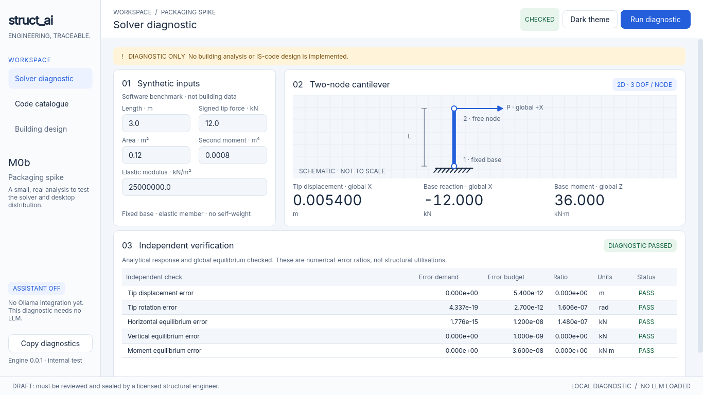

# struct_ai

**DRAFT · M0 foundation + M0b diagnostic prototype · NOT FOR BUILDING DESIGN**

A staged structural engineering application with a deterministic Python engine and a
service-only desktop interface. The current app runs a **real, independently checked
two-node OpenSeesPy cantilever diagnostic**. It does **not** analyse or design an RC
building, perform Indian Standard checks, or produce construction documents.

> DRAFT: must be reviewed and sealed by a licensed structural engineer.
> Do not use this prototype to issue designs or claim code compliance.

| Milestone | Current status |
|---|---|
| M0 — units, errors, checks, code provenance, service, tests | Complete; Linux and Windows CI pass |
| M0b — diagnostic desktop and packaging implementation | Implemented; Windows build and both frozen selftests pass |
| M0b — clean Windows/no-Python acceptance | **Pending**; not certified |
| M1–M15 — engineering, building workflow, full GUI, installer | Not implemented |

Workflow access is working and the implementation is pushed. **206 tests pass on both
Windows and Linux.** Windows CI built the onedir executable and passed both frozen
selftests using the native Windows Qt plugin, with matching source/frozen result hashes.
The CI host was Windows Server 2025—not a clean Windows 11 machine without Python.
[Recorded CI evidence](docs/evidence/m0b/windows-ci-2026-11-27/README.md) ·
[Milestone report and remaining acceptance gates](MILESTONE_REPORT.md).
Only evidence was uploaded; binary publication remains disabled pending licensing review.

## Desktop preview

Actual PySide6 captures of a real solver run, not mockups or made-up building results:



[Dark theme](docs/screenshots/m0b/dark-1366x768-scale-1-checked.png) ·
[Empty initial state](docs/screenshots/m0b/light-1366x768-scale-1-idle.png) ·
[Milestone report and evidence](MILESTONE_REPORT.md)

The app starts with **empty result fields**. Run diagnostic explicitly to produce
numbers. Editing an input clears stale results. The disabled Building design action
explains that engineering milestones are incomplete. There is no LLM dependency,
network service or model download needed to use the implemented diagnostic.

## Supported development/build versions

**Windows target (proposed): Windows 11 x64, CPython 3.12.10 x64.**

- OpenSeesPy / Windows native wheel: **3.7.1.2**.
- PySide6 **Essentials** / Shiboken: **6.8.3** — no PyQt or QtWebEngine.
- PyInstaller: **6.14.2**, hooks **2025.5**, **onedir** and windowed.
- Pydantic: **2.11.7**. Exact runtime/test/build pins: `requirements.lock`.

The Windows OpenSees wheel requires Python `~=3.12.0` and its loader enforces Python
3.12 / 64-bit, despite the broad wheel filename. Do not substitute Python 3.11 or
3.13 for a Windows build. Supplementary Linux tests here use Python 3.11.2 and the
pinned Linux native wheel; Linux evidence is not Windows acceptance.

### Windows source checkout

In Command Prompt, with CPython 3.12 x64 installed:

```bat
py -3.12 -m venv .venv
.venv\Scripts\python.exe -m pip install -r requirements.lock
.venv\Scripts\python.exe -m pip install --no-deps --no-build-isolation -e .
.venv\Scripts\python.exe -m struct_ai
```

The synthetic form inputs belong only to a software benchmark. They are **not** default
building geometry or material values. Positive force acts in global +X; negative force
reverses it. No self-weight, mass or shear deformation is included.

### Tests and audit

```bat
set QT_QPA_PLATFORM=offscreen
set PYTEST_QT_API=pyside6
set PYTHONUTF8=1
.venv\Scripts\python.exe tools\check.py
.venv\Scripts\python.exe tools\list_unverified.py
.venv\Scripts\python.exe -m struct_ai --selftest --output .artifacts\source-selftest.json
.venv\Scripts\python.exe -m struct_ai --gui-selftest --output .artifacts\source-gui-selftest.json
```

`tools/check.py` runs pytest, ruff lint and ruff format checks, returning nonzero on
failure. The recorded full CI gates at `8768572` passed **206 tests, zero skipped**, on
both Windows and Ubuntu 24.04. Tests exercise actual OpenSees, spawned workers and Qt
widgets, not mocked engineering functions. Ruff/format and `pip check` also passed.
The restricted local sandbox ran the expanded **190-test headless subset**; its graphics
prerequisites remain absent, so that local subset is not a full GUI/frozen rerun. See
[current CI evidence](docs/evidence/m0b/windows-ci-2026-11-27/README.md) and the
[earlier restoration record](docs/evidence/m0b/continuation-2026-11-27.json). The historical
190-test full suite predates the added regression tests. No textbook placeholder tests
exist because no code-design module exists.

To return to the ordinary Windows display after offscreen tests, run
`set QT_QPA_PLATFORM=` before launching the source app normally.

### Linux development

Install the matching Python development/shared-runtime package and native prerequisites
(`libgl1`, `libegl1`, `libxkbcommon0`, `libdbus-1-3`, `libblas3`, `liblapack3`) through your
OS package manager. Create a Python 3.11/3.12 venv, install the same lock file, then use
`QT_QPA_PLATFORM=offscreen PYTEST_QT_API=pyside6 python tools/check.py` in headless CI.
A Linux freeze additionally needs a compatible `libpython` shared library.
See [packaging notes](docs/packaging-spike.md) for the restricted sandbox's supplementary
test environment and its limitations; scratch native dependencies are not committed.

## Packaging and Windows acceptance

```bat
packaging\build_windows.bat
```

This runs pinned installation → pytest/ruff → PyInstaller → real frozen headless and
GUI-worker selftests. It produces an **entire onedir folder**, not a standalone EXE.
The Windows smoke runner exercises the native Windows Qt platform plugin with Python
removed from PATH; Linux smoke uses offscreen rendering. It compares headless/GUI
result hashes and removes external Python/library/plugin path overrides. CI builds/tests
now run automatically; binary artifact upload is a separate manual opt-in after
distribution-permission review. In a public repository, a diagnostic
artifact's label is not an access restriction.

**No clean-Windows test has been performed.** Follow the documented
[clean-VM procedure](docs/packaging-spike.md#clean-windows-acceptance--must-actually-be-performed)
with both the local build and CI artifact. Python/Qt/OpenSees/Ollama must be absent on
that machine. Record actual exit codes, evidence JSON, OS build, artifact hash and
native screenshots before accepting M0b. M14's beam/DOCX/DXF selftest and Inno Setup
installer are not implemented.

The spike is unsigned. See the packaging notes for antivirus/SmartScreen precautions
and a future code-signing plan. Do not disable security protections to run a build.

### Distribution licence blocker

The actual bundled **OpenSeesPy licence requires a separate licence for commercial
redistribution**. Internal/research/education permissions do not establish permission
to ship a commercial application. PySide6 is used under its LGPL alternative with
replaceable dynamic libraries; Inter includes its SIL OFL licence. See
[third-party notices](struct_ai/gui/resources/NOTICES.md). A release licence audit is
still required; no public commercial installer/release was created.

## Architecture and traceability

```text
Client (desktop / CLI / future LLM tool)
    → services/engine_service.py   [only engine entry point]
    → strict validated input
    → deterministic solver + independent verification
    → immutable result + CheckResults + actual-use code provenance + SHA-256
    → display/export of those same objects
```

The present schema is `DiagnosticInput`, **not** a substitute `BuildingInput`.
`design_building()` refuses every request with `NotImplementedError`. Slab, footing,
staircase design and BuildingInput project I/O also refuse explicitly.

The diagnostic uses fixed stages: validation → model → linear static analysis →
independent analytical/equilibrium checks. The GUI only supplies text fields and
renders service outputs. A **QThread** owns service-process startup, polling and cleanup;
OpenSees itself runs in an isolated spawned child. UI signals return to the main thread.
Cancellation terminates the child and suppresses even an already-queued late result.
OpenSees domains are wiped before/after runs and concurrent in-process calls are rejected.

Each numerical check retains `name`, `ok`, `clause`, `demand`, `capacity`, `ratio` and
`units`. Diagnostic checks compare **numerical error** to a documented numerical error
budget, not member utilisation. Raw signed solver outputs are preserved. Conversions
between kN/m and N/mm/N/mm² live only in `struct_ai/units.py`.

Canonical payloads exclude timestamps and machine-dependent paths. Identical validated
inputs, code-data revision and pinned engine environment reproduce identical results;
that is tested in-process, across source workers and across frozen headless/GUI paths.
Different OS/toolchain environments are not assumed bit-identical.

## Code source-of-truth policy

No Indian Standard values or clauses have been implemented. The four required JSON
catalogues are deliberately **empty**. Empty is not verified. Required absent/null
values raise `MissingCodeValue`; incomplete source metadata also blocks consumption.
No remembered code values are silently adopted.

Future shipped records must have `verified=false`, `verified_by=null`, explicit units,
code edition and clause references. The actual-use tracker records distinct consumed
constants and emits `UNVERIFIED CODE CONSTANTS USED: N` when N > 0. Audit inventory
counts and per-run usage counts are deliberately different. See
[the code-data policy](docs/CODE_DATA_POLICY.md).

## Screenshots, logs and next gates

```sh
QT_QPA_PLATFORM=offscreen python tools/make_screenshots.py
QT_QPA_PLATFORM=offscreen python tools/make_screenshots.py --scale 1.25 --sizes 1366x768 --checked-only
QT_QPA_PLATFORM=offscreen python tools/make_screenshots.py --scale 1.5 --sizes 1366x768 --checked-only
```

The 12 captures cover the one implemented page in both themes at 1366×768 and
1920×1080 logical pixels, plus scaled captures. Manifests record physical pixel sizes
and actual result hashes. KPI size/contrast/accessibility tests run automatically.
Native Windows DPI testing and design feedback are still required before later UI work.

Logs: `%APPDATA%\struct_ai\logs` on Windows, XDG state storage on Linux. Copy diagnostics
shows versions and the log path without exposing environment secrets.

Next gates: validate an authorised Windows artifact on a **separate clean machine**;
resolve redistribution licensing; review
[the public-reference shortlist and M1 data needs](docs/research/M1_PUBLIC_REFERENCES.md)
and supply the unresolved design-basis information. That shortlist is not runtime code data.
**Do not advance to engineering milestones on the strength of a passing two-node diagnostic.**
See [known limitations](docs/KNOWN_LIMITATIONS.md) and the
[human-verification checklist](MILESTONE_REPORT.md).
